# BÁO CÁO BÀI TẬP 

## THÔNG TIN SINH VIÊN
- **Họ và tên:** Nguyễn Thành Đạt
- **Mã số sinh viên:** 24810340130
- **Lớp:** D19QTANM1
- **Tên môn học:** Lập trình C# / Windows Forms
- **Tên bài tập:** [Bài 4.6-4.7-4.8]

---

## KẾT QUẢ THỰC HÀNH
### BÀI 4.6 
### 1. Ảnh màn hình Giao diện chính
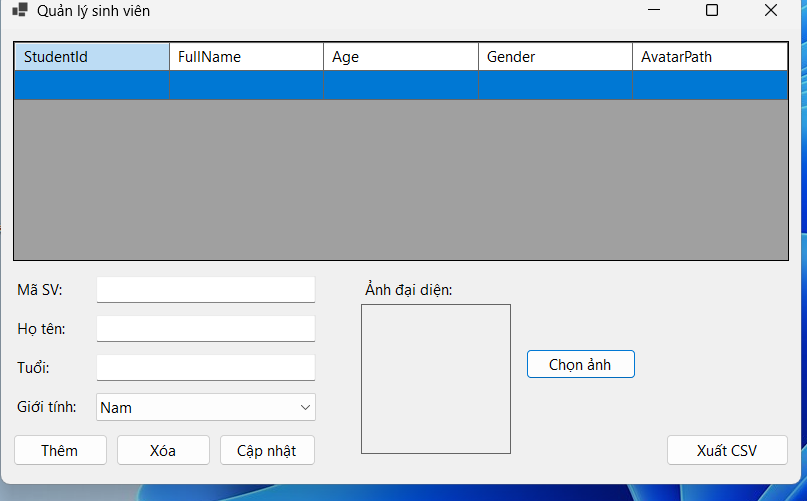

### 2. Ảnh màn hình Chức năng thực thi / Kết quả
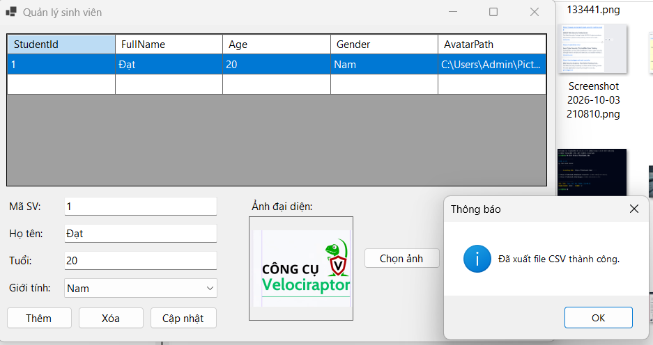
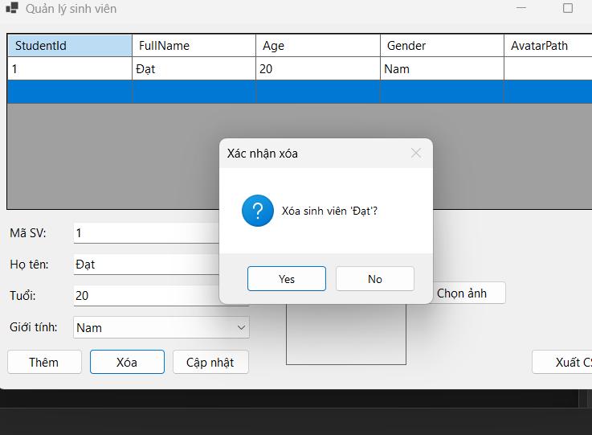
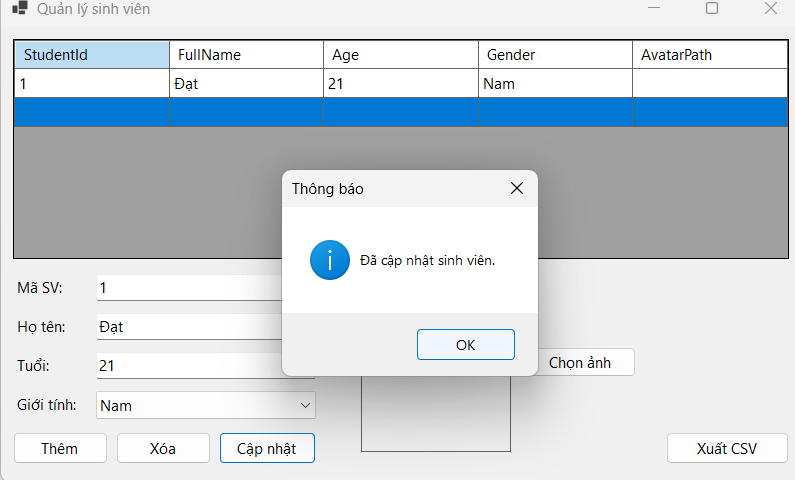

### 3. Ảnh màn hình Kiểm tra lỗi (Validation)
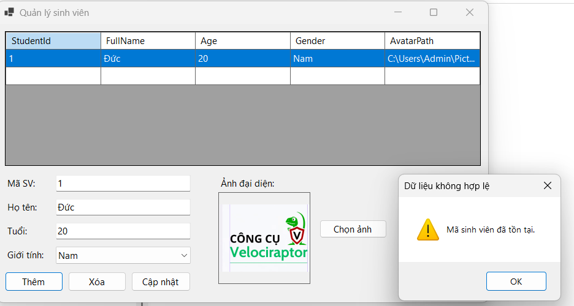

### BÀI 4.7
### 1. Ảnh màn hình Giao diện chính
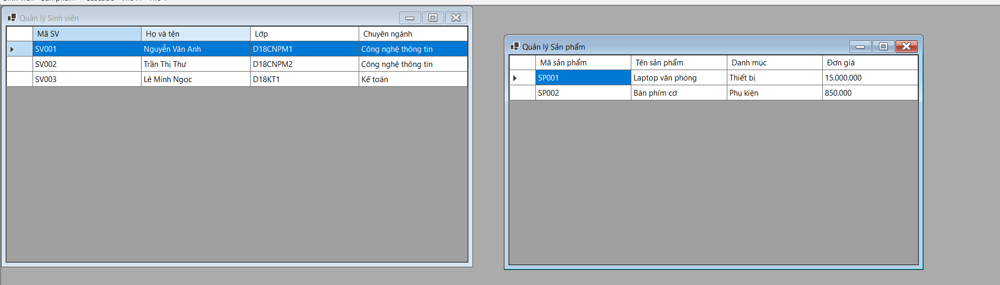

### 2. Ảnh màn hình Chức năng thực thi / Kết quả
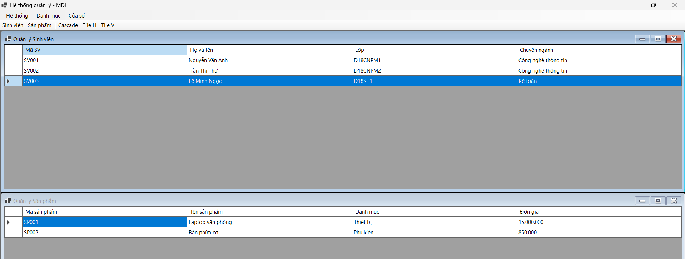
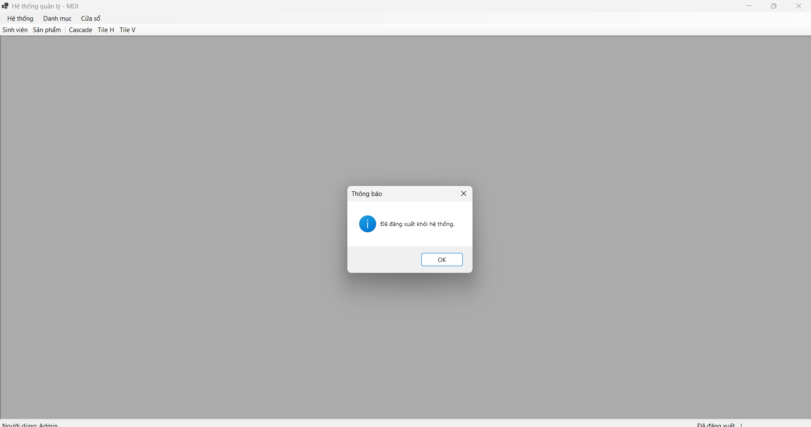
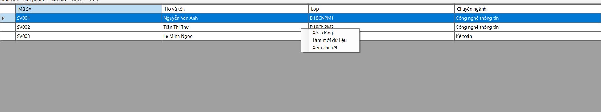
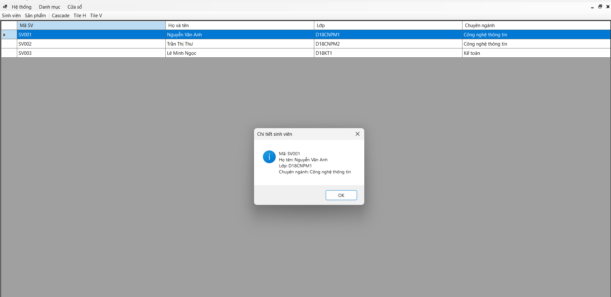
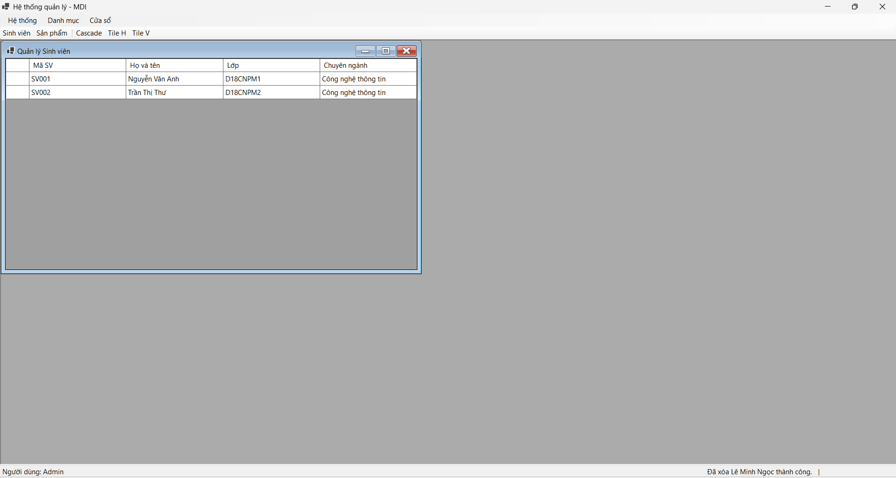

### BÀI 4.8
### 1. Ảnh màn hình Giao diện chính
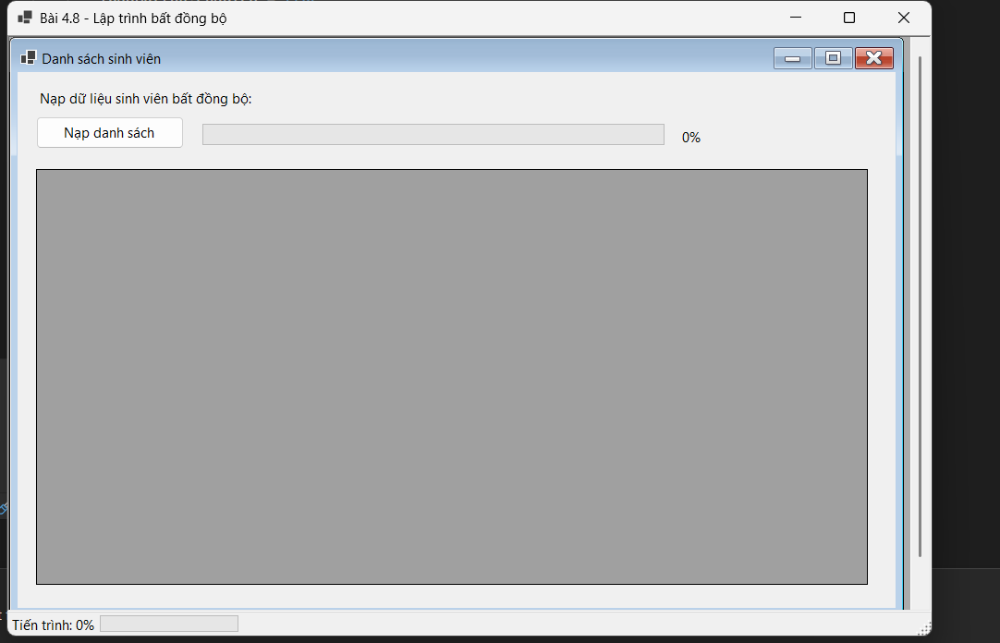

### 2. Ảnh màn hình Chức năng thực thi / Kết quả
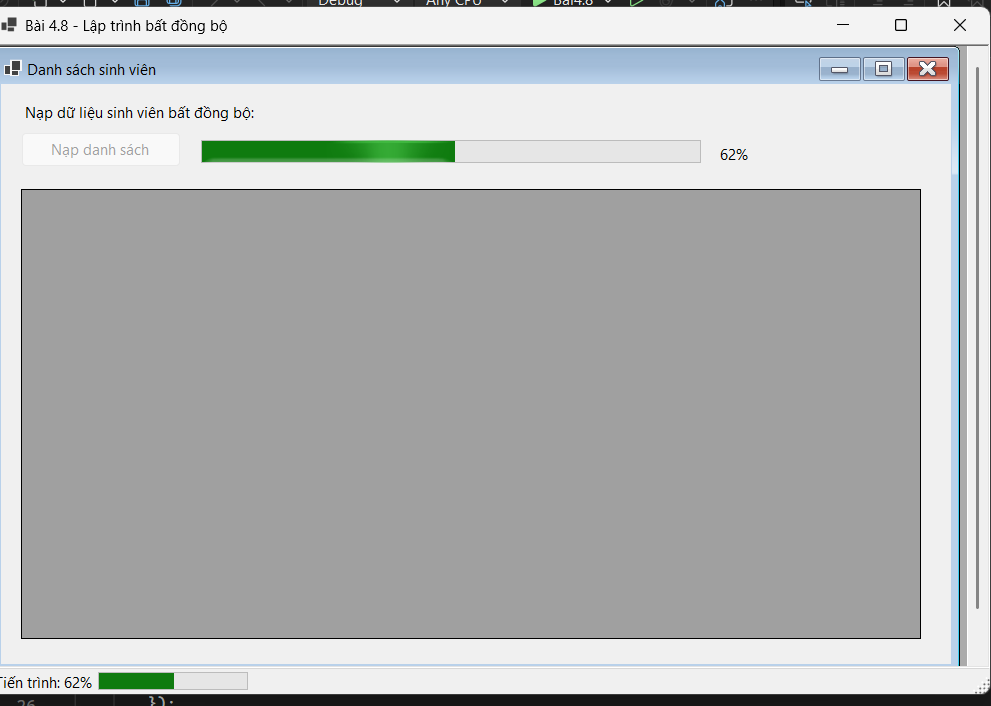
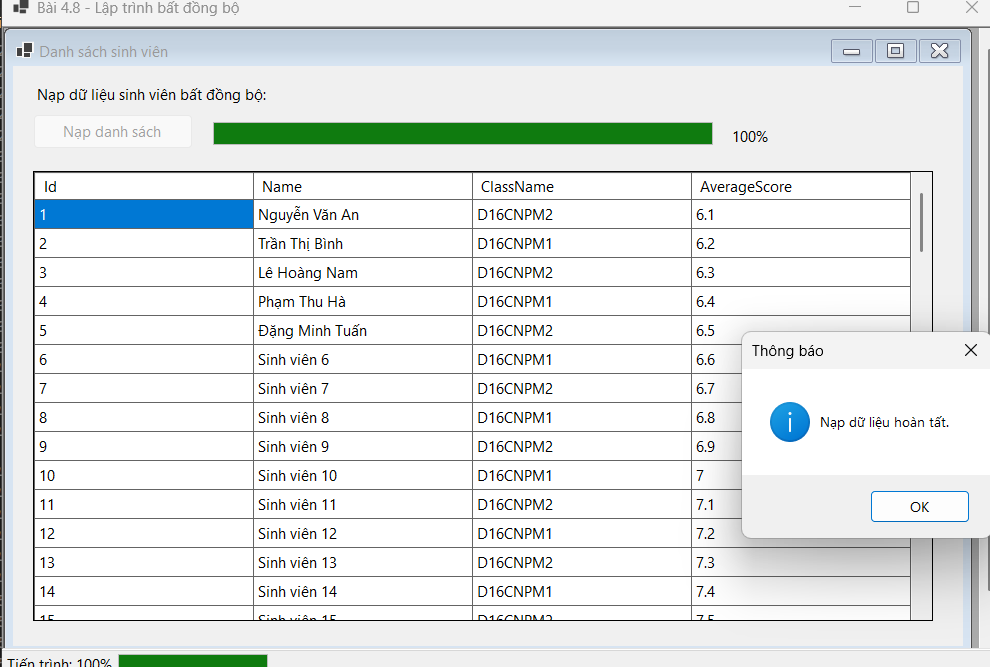
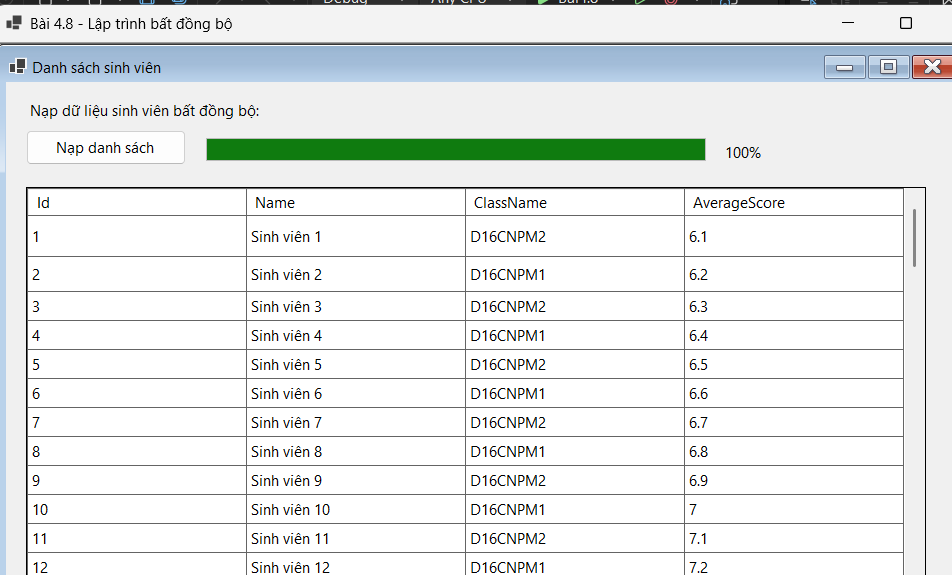

