# BÁO CÁO BÀI TẬP 

## THÔNG TIN SINH VIÊN
- **Họ và tên:** Nguyễn Thành Đạt
- **Mã số sinh viên:** 24810340130
- **Lớp:** D19QTANM1
- **Tên môn học:** Lập trình C# / Windows Forms
- **Tên bài tập:** [Bài tập 4.9-4.10-4.11]

---

## KẾT QUẢ THỰC HÀNH
### BÀI 4.9
### 1. Ảnh màn hình Giao diện chính
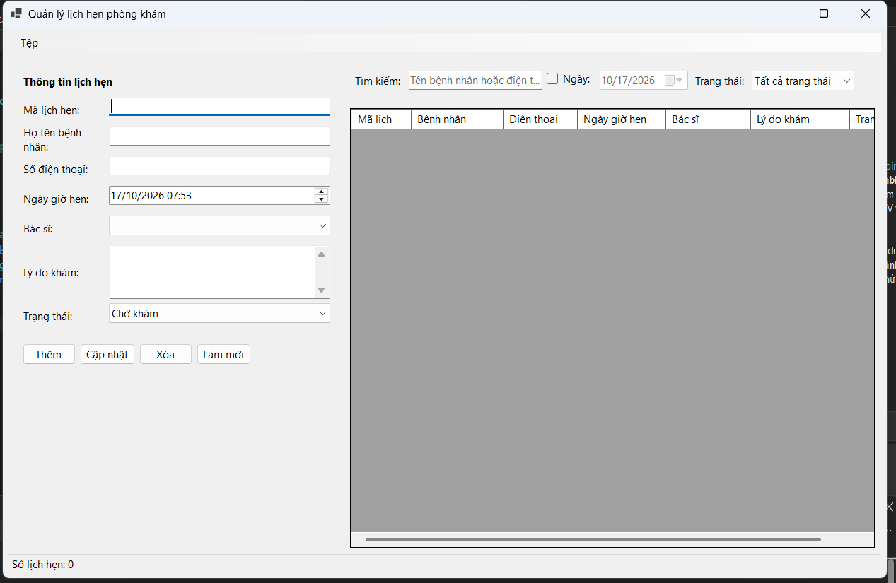

### 2. Ảnh màn hình Chức năng thực thi / Kết quả
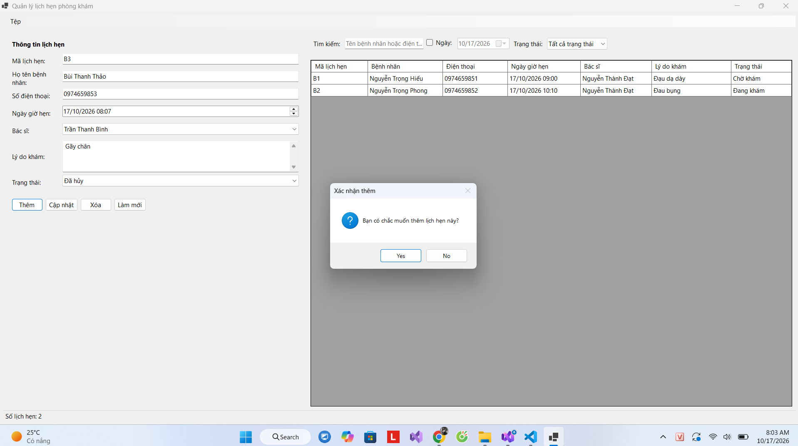
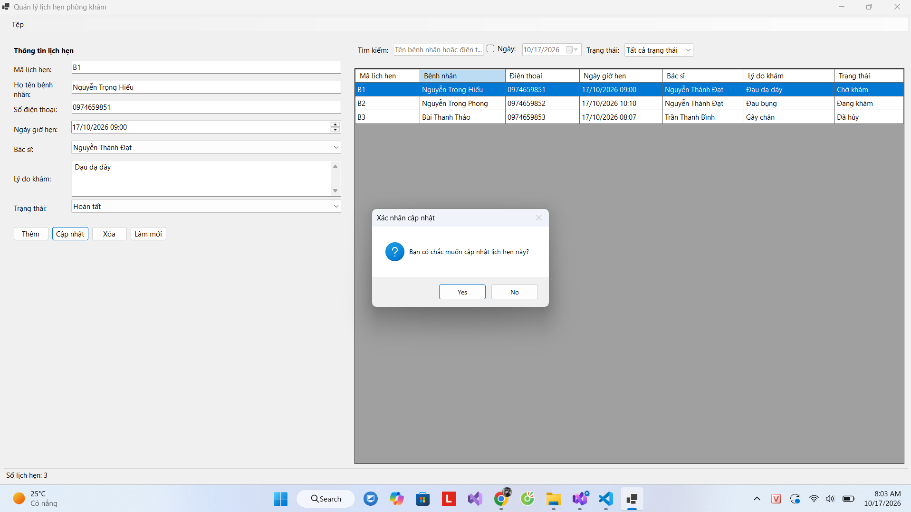
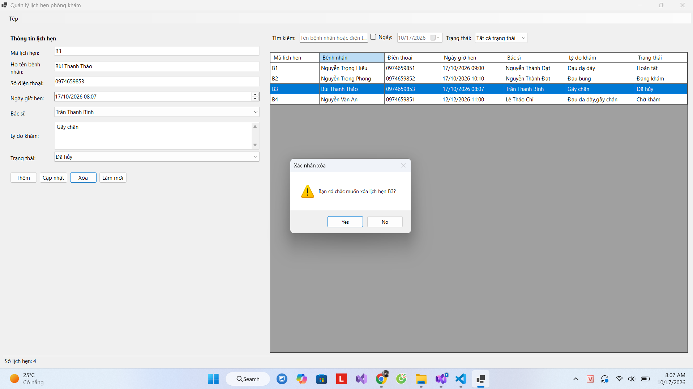
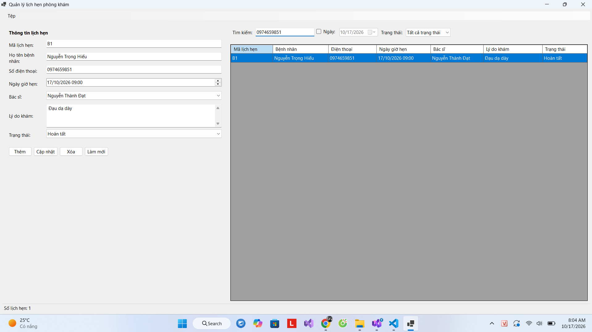

### 3. Ảnh màn hình Kiểm tra lỗi (Validation)

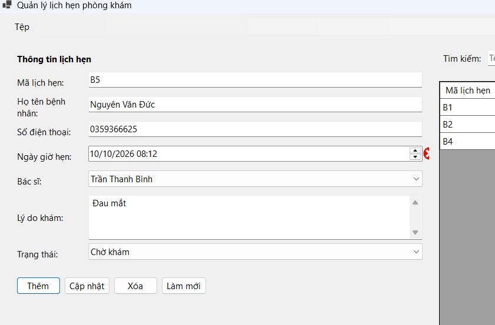

### BÀI 4.10
### 1. Ảnh màn hình Giao diện chính
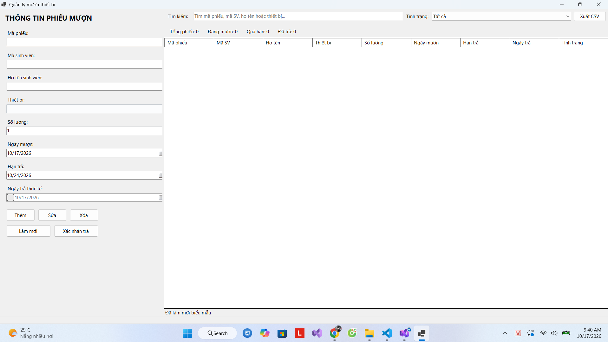

### 2. Ảnh màn hình Chức năng thực thi / Kết quả
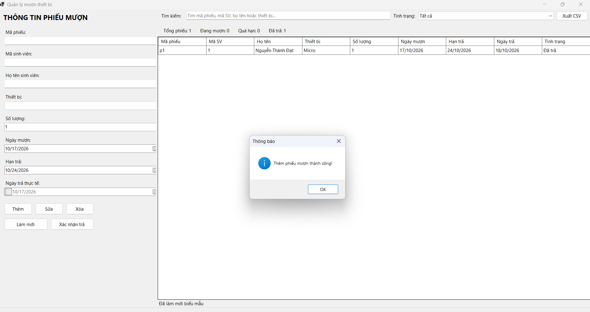

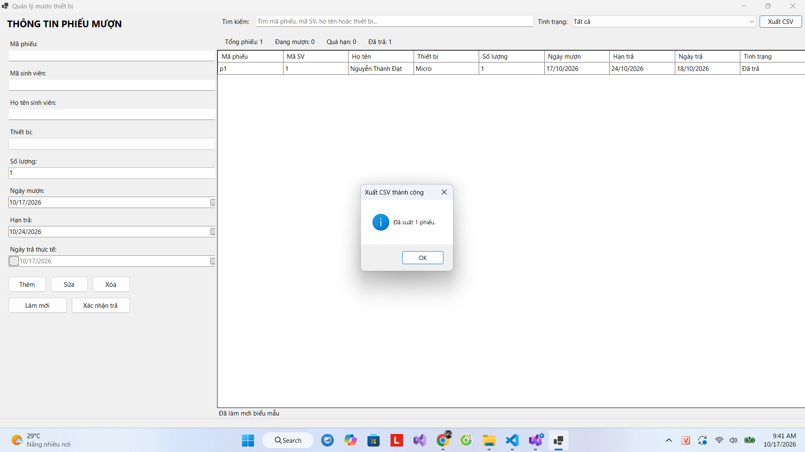
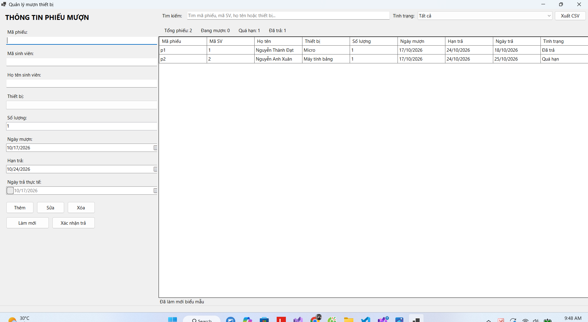

### 3. Ảnh màn hình Kiểm tra lỗi (Validation)

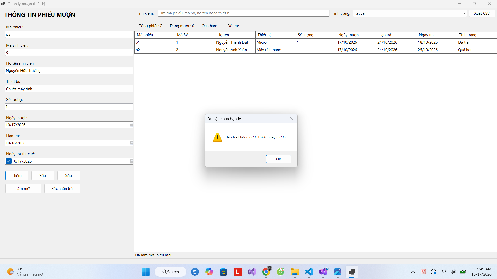

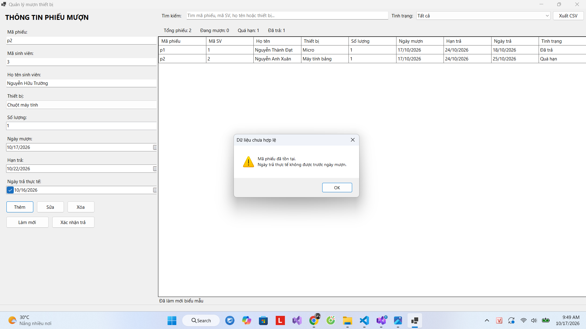

### BÀI 4.11
### 1. Ảnh màn hình Giao diện chính
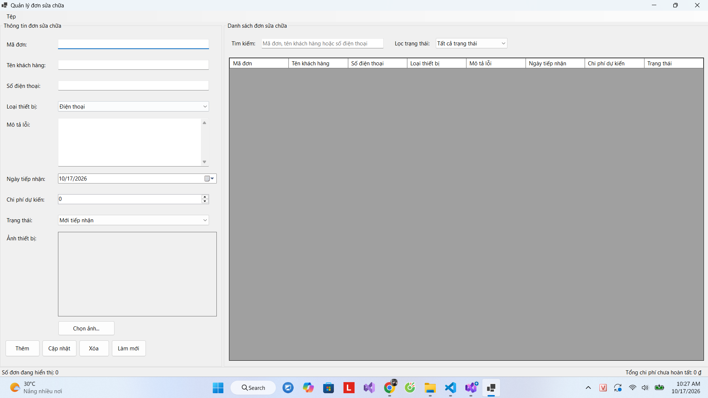

### 2. Ảnh màn hình Chức năng thực thi / Kết quả
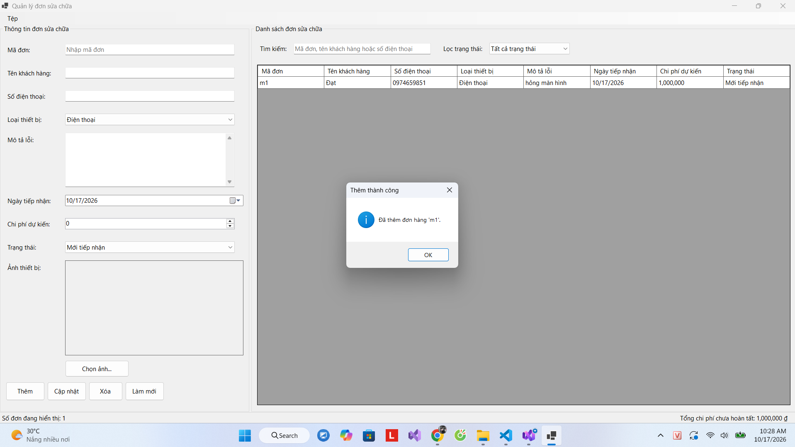

### 3. Ảnh màn hình Kiểm tra lỗi (Validation)

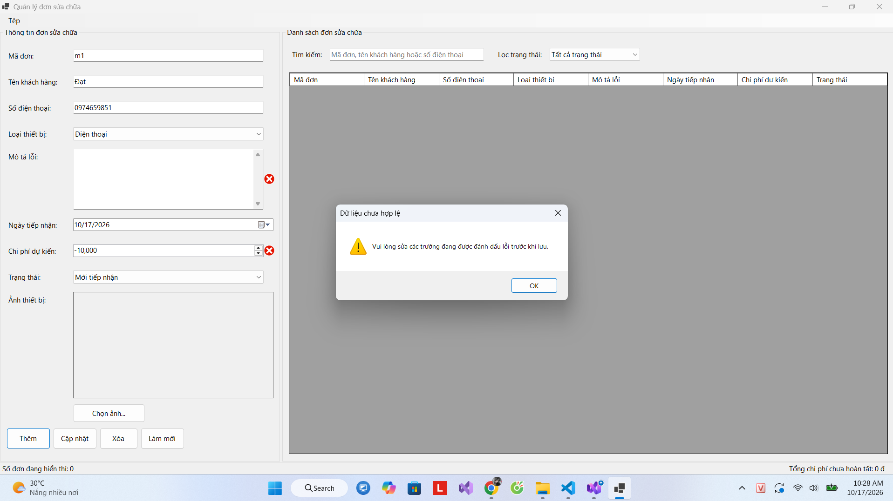
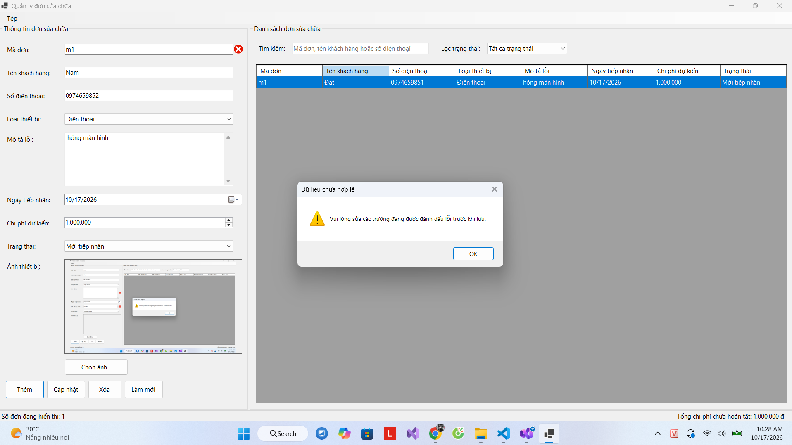

