# MỤC 1: THÔNG TIN SINH VIÊN
- Họ và tên sinh viên: Nguyễn Thành Đạt
- Mã sinh viên: 24810340130
- Lớp / Khóa: [D19QTANM1]
- Bài Tập : Bài 6.1 - 6.2

# MỤC 2: HÌNH ẢNH KẾT QUẢ CÁC MÀN HÌNH CHỨC NĂNG

### Bài 6.1
1. Màn hình Chính / Tổng quan hệ thống:
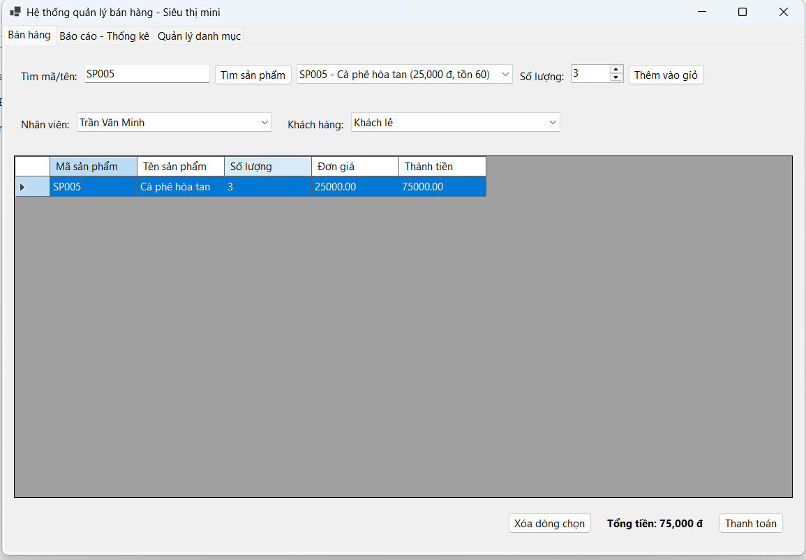
2. Màn hình Quản lý Danh mục (CRUD - Thêm/Sửa/Xóa):
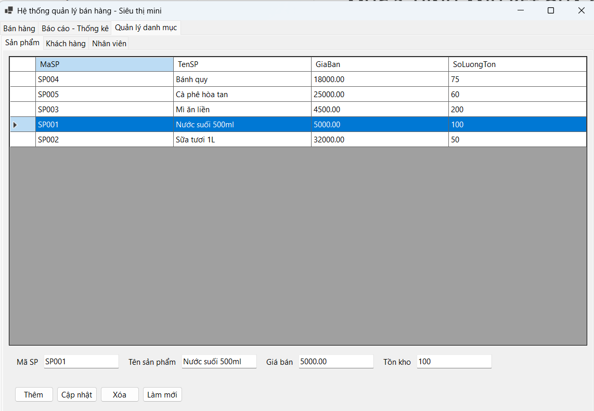
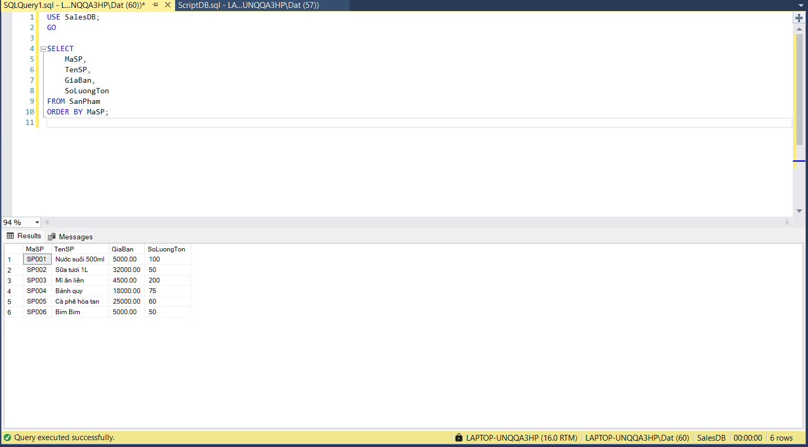

3. Màn hình Thực thi Nghiệp vụ chính (Lập Hóa đơn / Bán hàng /
Chấm công / Đặt phòng):
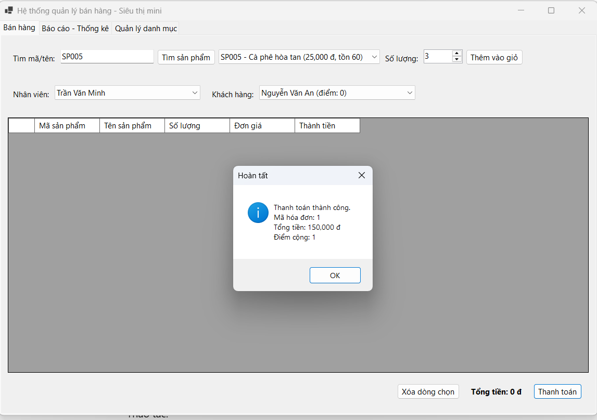
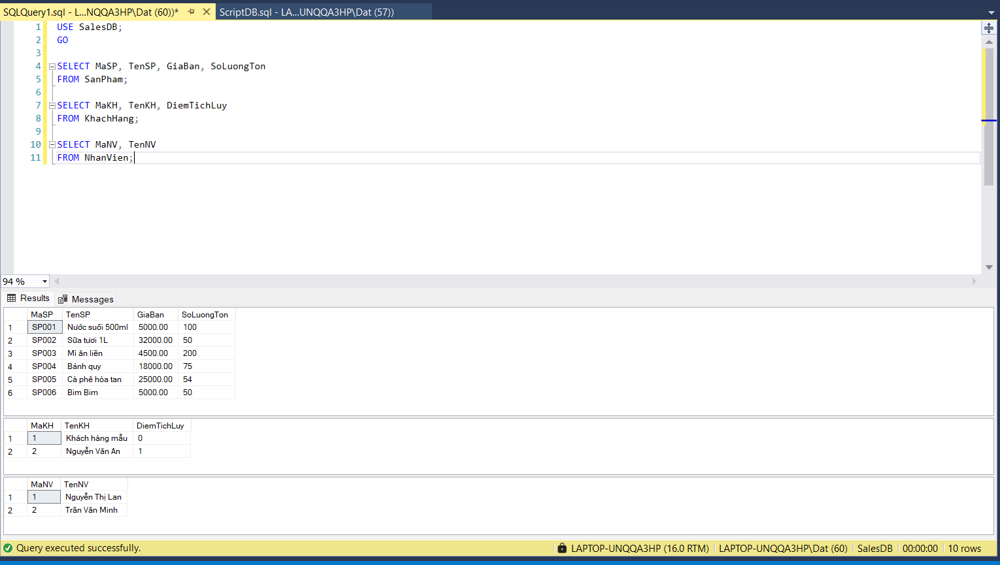
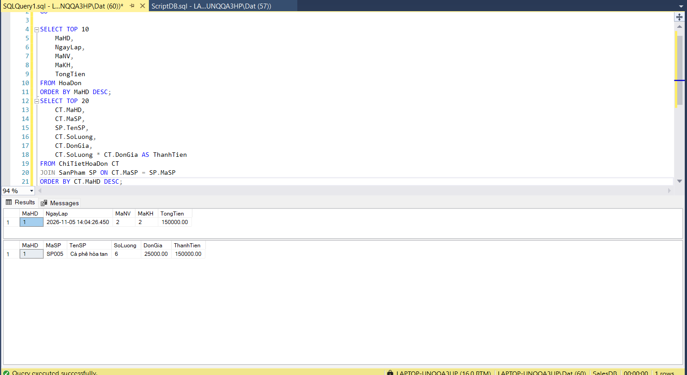

4. Màn hình Báo cáo - Thống kê:
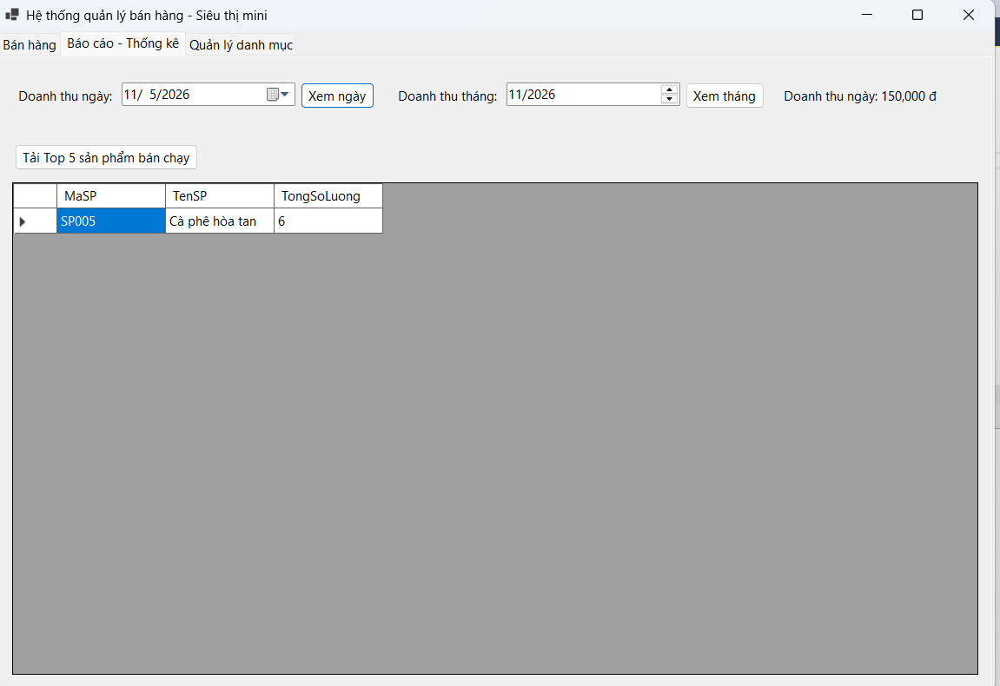
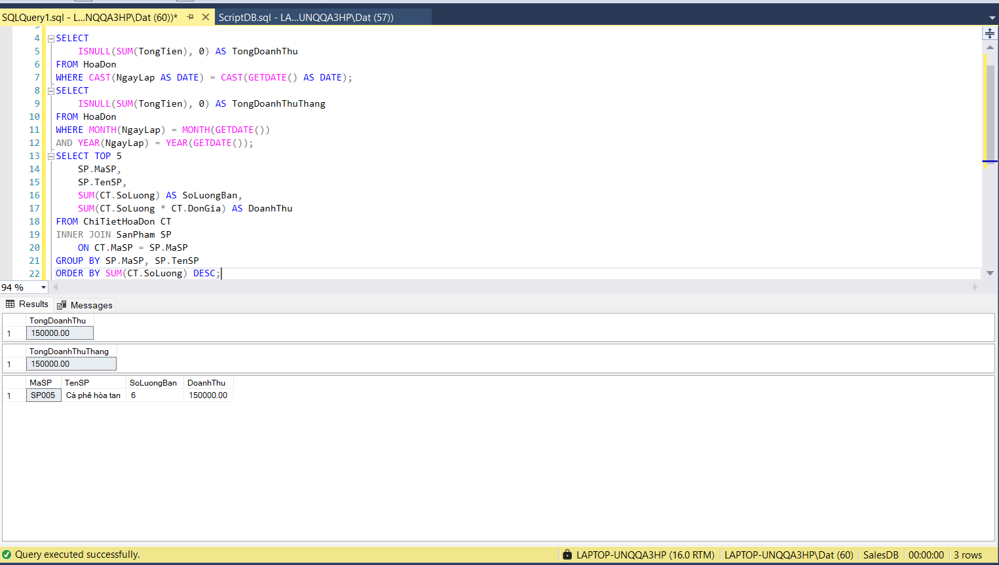
5. Minh họa An toàn Dữ liệu (Phòng chống SQL Injection / Báo lỗi
Transaction Rollback):
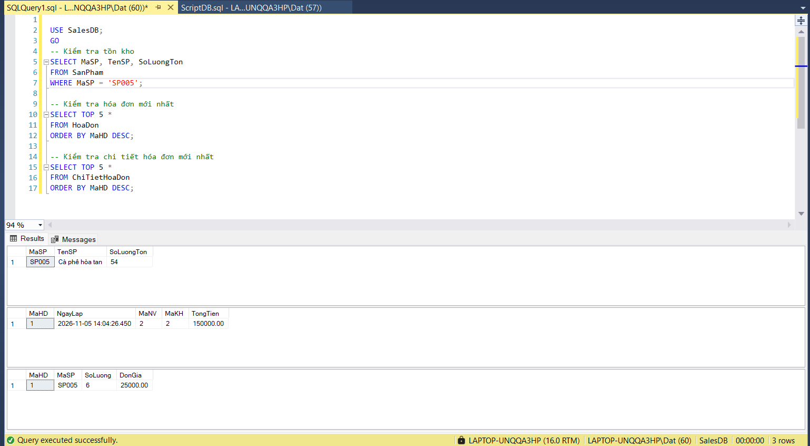

### Bài 6.2
1. Màn hình Chính / Tổng quan hệ thống:
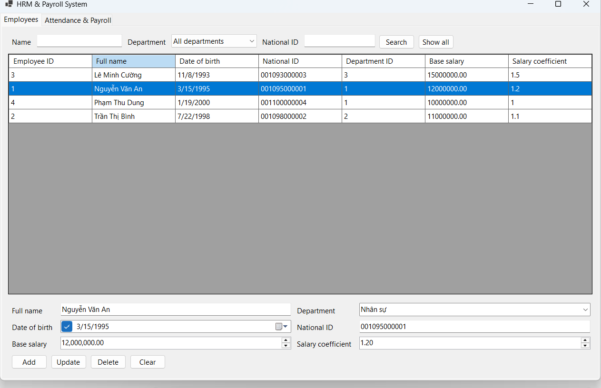
2. Màn hình Quản lý Danh mục (CRUD - Thêm/Sửa/Xóa):
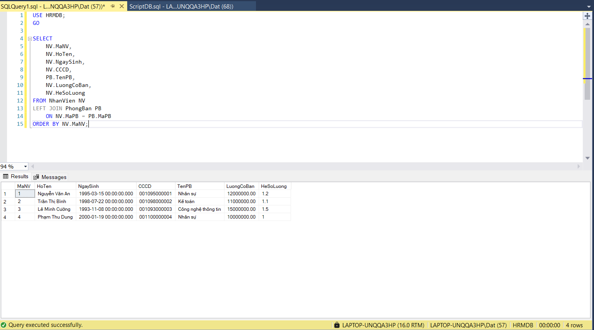

3. Màn hình Thực thi Nghiệp vụ chính (Lập Hóa đơn / Bán hàng /
Chấm công / Đặt phòng):
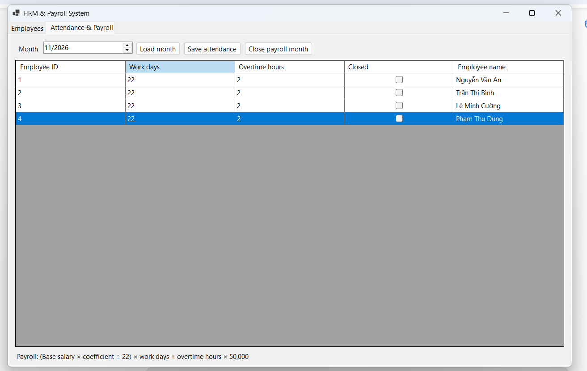
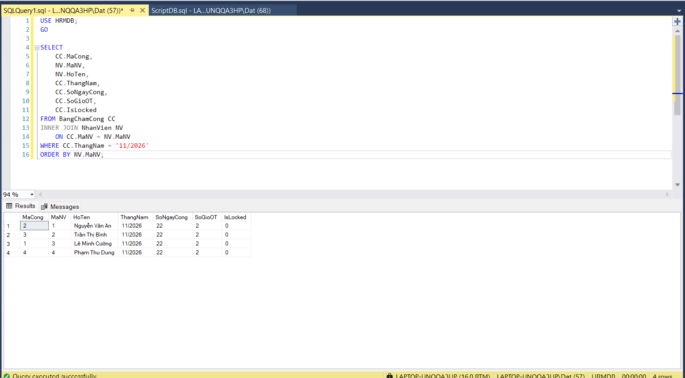

4. Màn hình Báo cáo - Thống kê:

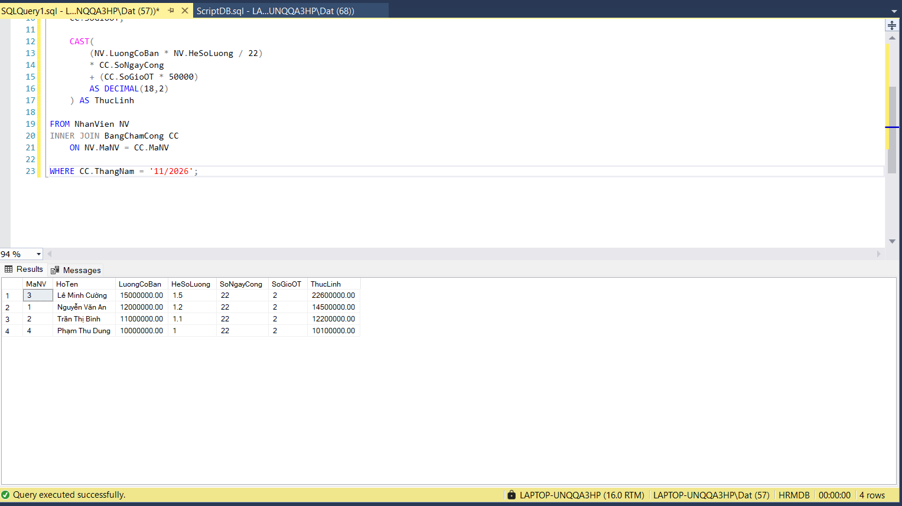

5. Minh họa An toàn Dữ liệu (Phòng chống SQL Injection / Báo lỗi
Transaction Rollback):

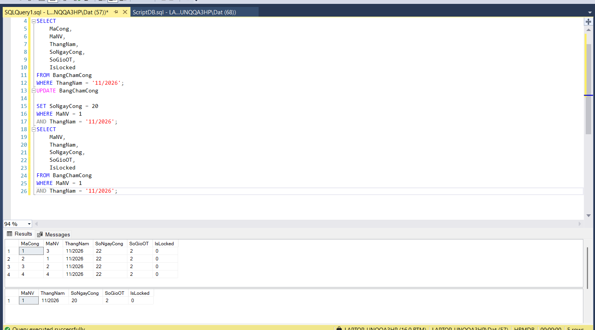

