# MỤC 1: THÔNG TIN SINH VIÊN

• Họ và tên sinh viên: Nguyễn Thành Đạt

• Mã sinh viên: 24810340130

• Lớp:D19QTANM1

• Tên Đề tài / Bài tập: [bài 5.3-5.4-5.5]

# MỤC 2: HƯỚNG DẪN CÀI ĐẶT & CHẠY DỰ ÁN
• Các bước cài đặt:

1. Mở SQL Server Management Studio (SSMS), chạy file
Database/ScriptDB.sql để khởi tạo CSDL và dữ liệu mẫu.
2. Mở file .sln bằng Visual Studio 2022.
3. Mở file cấu hình (App.config hoặc DatabaseHelper.cs), sửa lại chuỗi
kết nối ConnectionString cho phù hợp với máy cá nhân.
4. Build & Run dự án (F5).
# MỤC 3: HÌNH ẢNH KẾT QUẢ CÁC MÀN HÌNH CHỨC NĂNG
### bài 5.3
## 1. Màn hình chính / Tổng quan
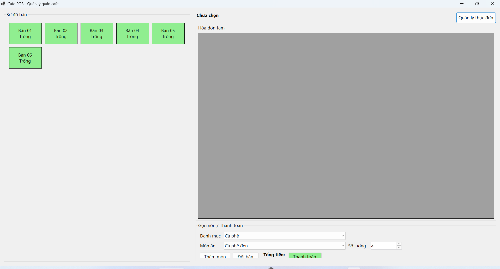

## 2. Màn hình Quản lý danh mục / CRUD
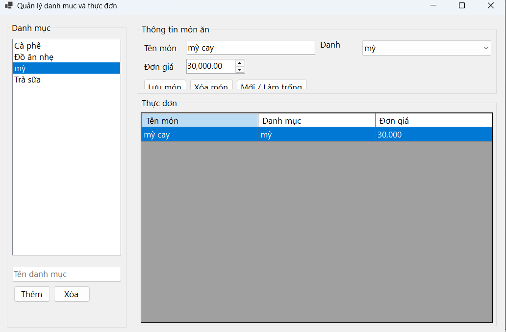

## 3. Màn hình Thực thi nghiệp vụ chính
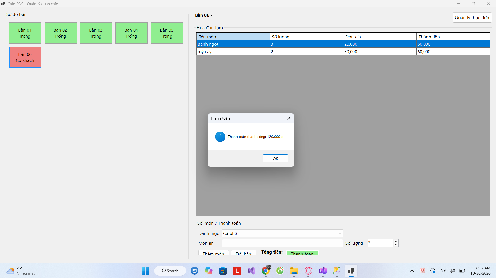
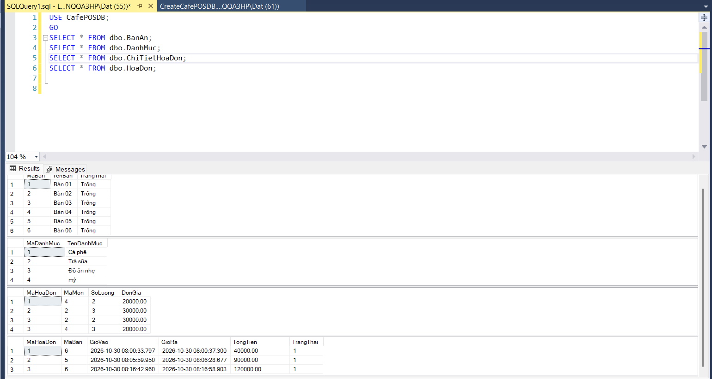
### bài 5.4
1. Màn hình Chính / Tổng quan:

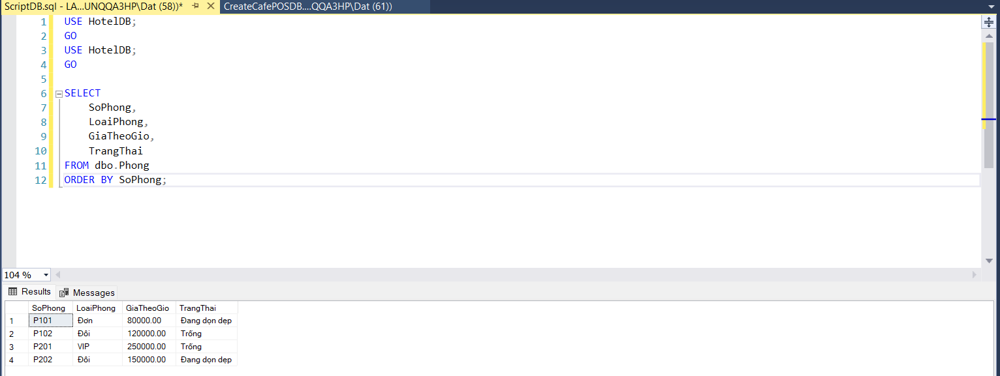
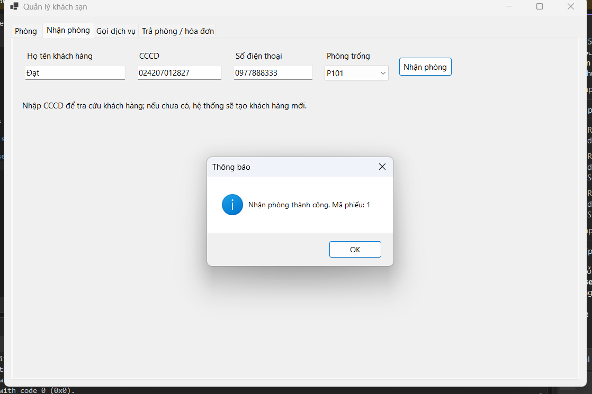

2. Màn hình Quản lý Danh mục / Thêm Sửa Xóa (CRUD):
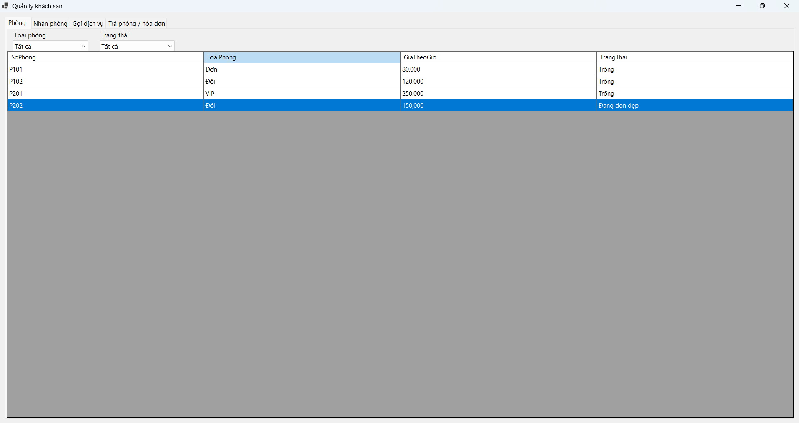
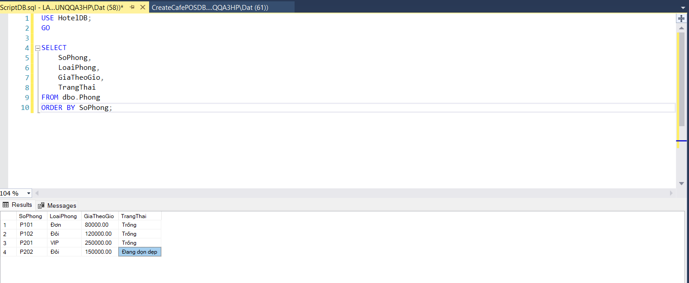
3. Màn hình Thực thi Nghiệp vụ chính (Lập phiếu / Gọi món / Check-
in):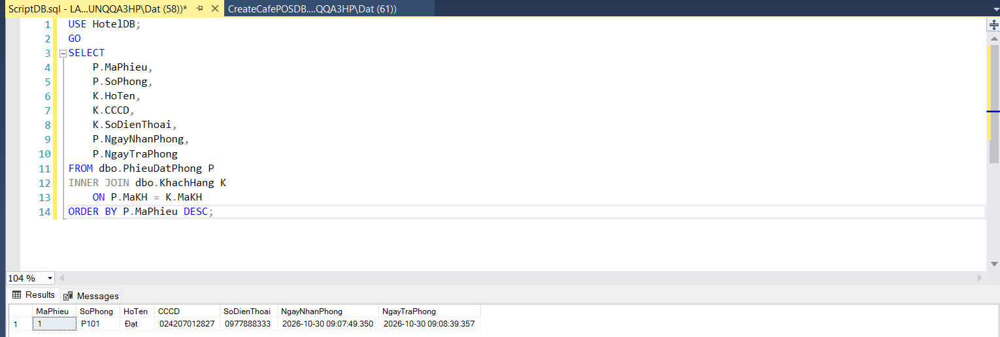

4. Màn hình Báo cáo - Thống kê:
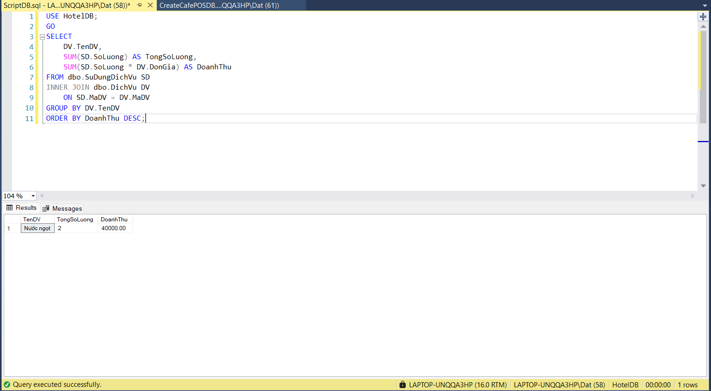
5. Minh họa chống SQL Injection hoặc Báo lỗi Giao dịch
(Rollback):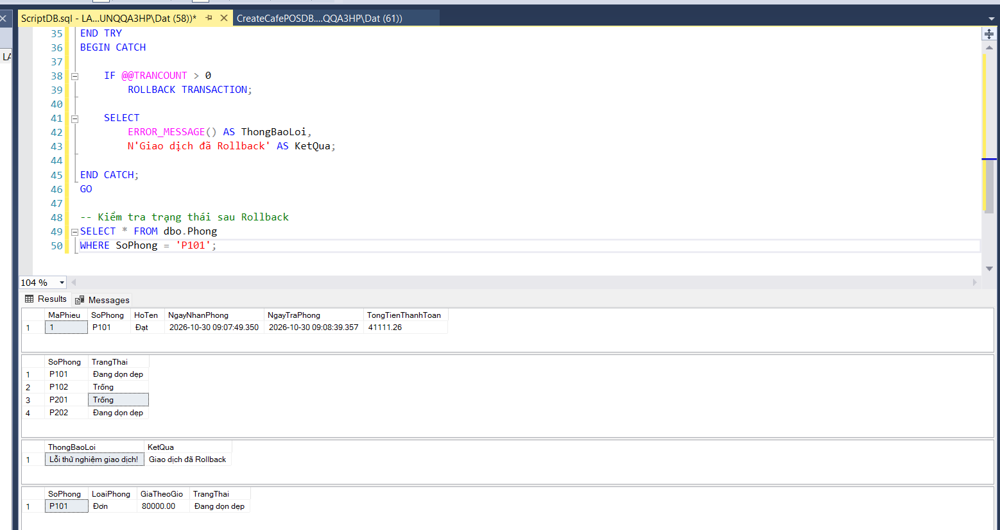
### bài 5.5
1. Màn hình Chính / Tổng quan:
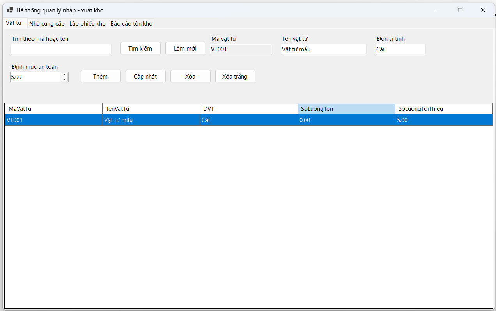
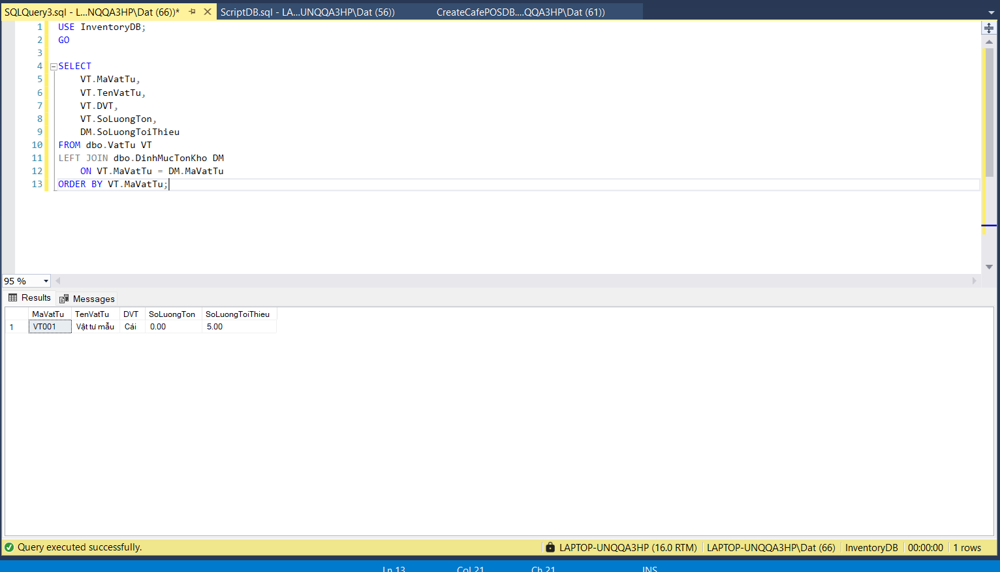
2. Màn hình Quản lý Danh mục / Thêm Sửa Xóa (CRUD):
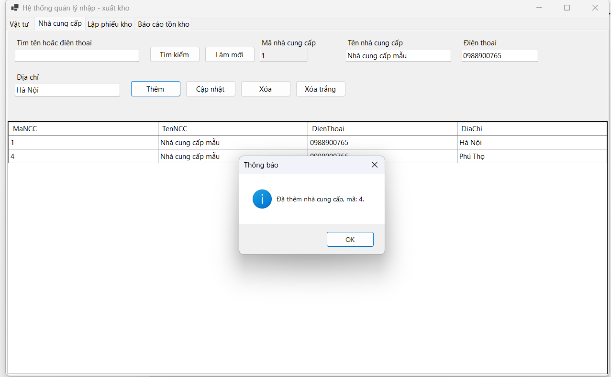

3. Màn hình Thực thi Nghiệp vụ chính (Lập phiếu / Gọi món / Check-
in):
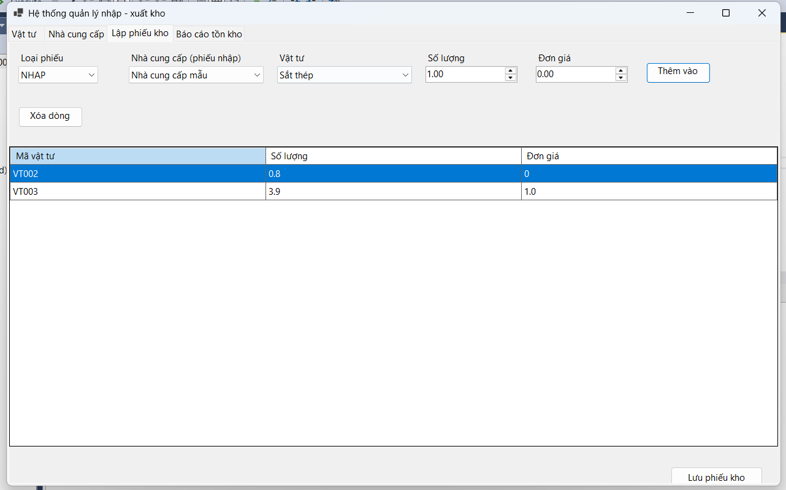
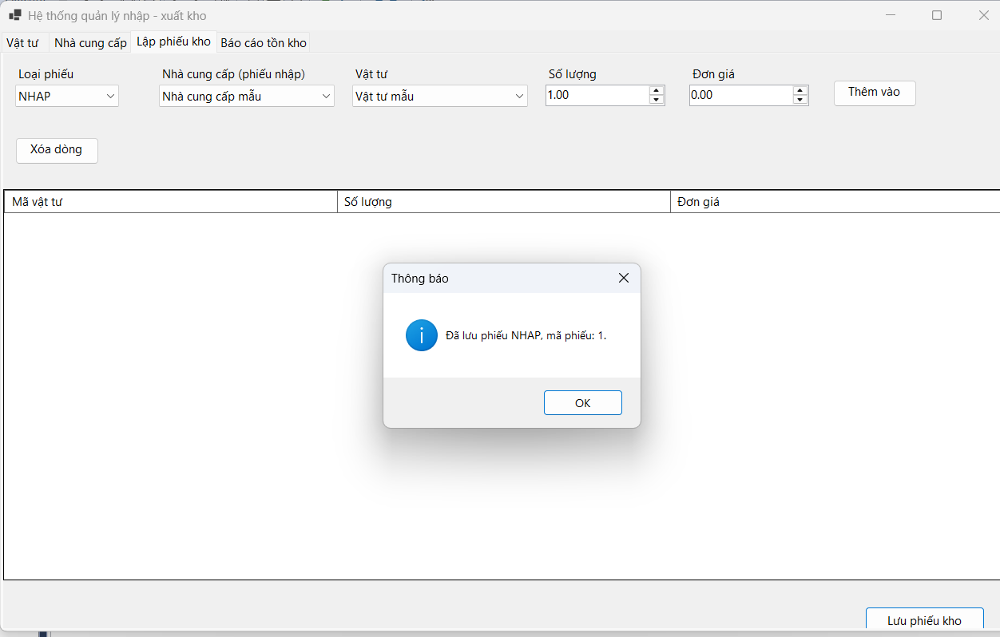
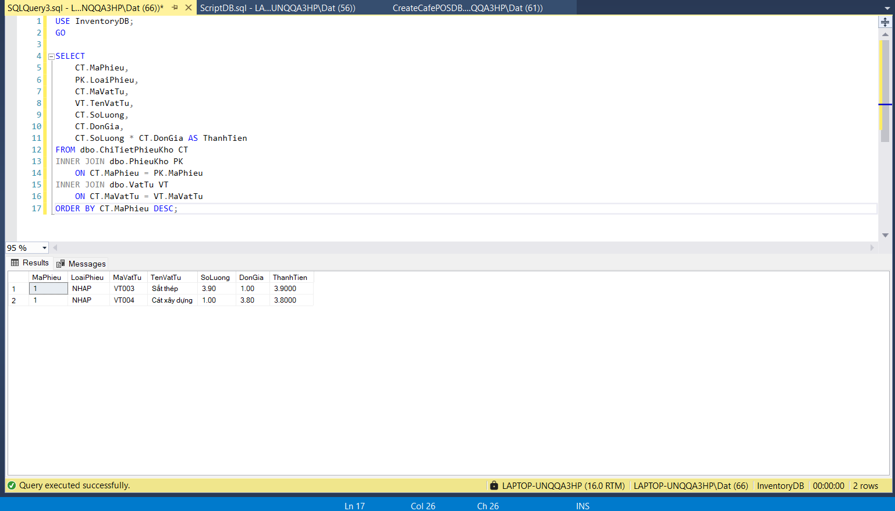

4. Màn hình Báo cáo - Thống kê:
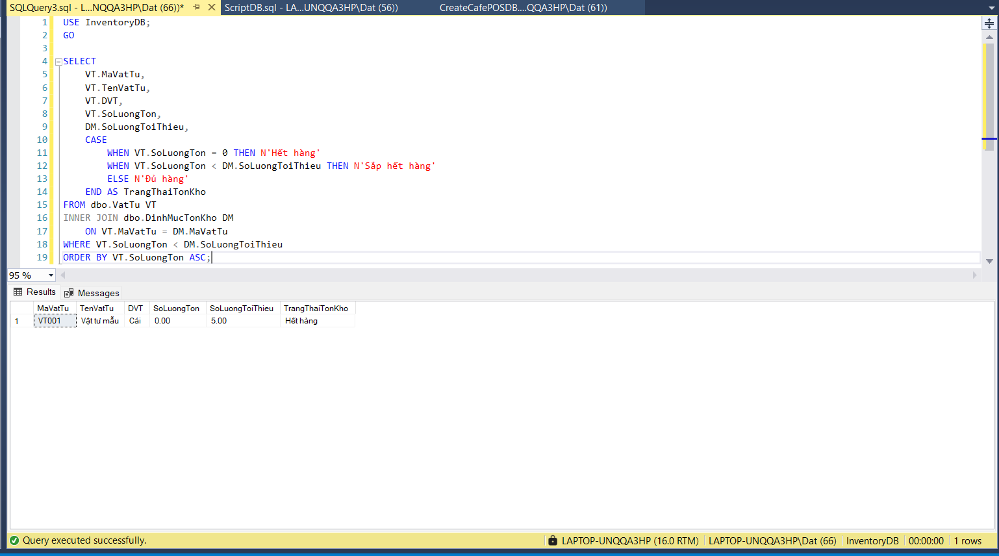

