# BÁO CÁO BÀI TẬP THỰC HÀNH LẬP TRÌNH C# WINFORMS

## I. THÔNG TIN SINH VIÊN
- **Họ và tên:** Nguyễn Thành Đạt
- **Mã số sinh viên:** 24810340130
- **Lớp:** D19QTANM1
- **Tên môn học:** Lập trình C# / Windows Forms
- **Tên bài tập:** [D19QTANM1-LTNET-TEST02]

---
### I. DANH SÁCH BÀI TẬP HOÀN THÀNH & TỰ ĐÁNH GIÁ

| Bài tập | Tiêu đề bài tập | Trạng thái | Mức độ hoàn thành (%) |
| :---: | :--- | :---: | :---: |
| **Bài 1** | Quản lý Dịch vụ Phòng Gym & Hội viên | Hoàn thành | 100% |
| **Bài 2** | Báo cáo & Lưu trữ Tài liệu Nhà sách | Hoàn thành | 100% |
| **Bài 3** | Hệ thống MDI Quản lý Bệnh viện & Async | Hoàn thành | 100% |
| **Bài 4** | BẢNG ĐIỀU KHIỂN THỐNG KÊ DOANH THU MULTI-THREADING  | Hoàn thành | 100% |
| **Bài 5** | MÔ PHỎNG GIÁM SÁT TỶ GIÁ TÀI CHÍNH THỜI GIAN THỰC | Hoàn thành | 100% |
### II. MINH HỌA GIAO DIỆN & KỸ THUẬT NỔI BẬT
### 1. Bài 1: Quản lý Dịch vụ Phòng Gym & Hội viên
* **Kỹ thuật áp dụng:** Cấu hình DataGridView bằng code (`AutoGenerateColumns =
false`), Data Binding 2 chiều với `BindingSource`,
### 1. Ảnh màn hình Giao diện chính
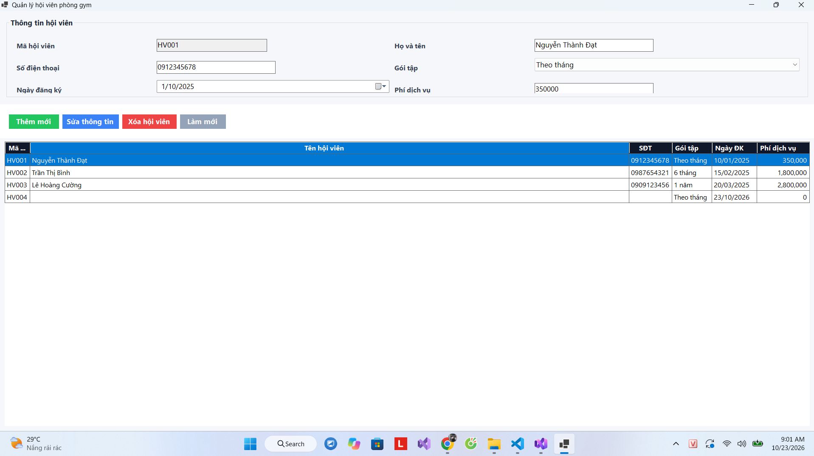
*Mô tả: Giao diện chính hiển thị DataGridView và đồng bộ dữ liệu 2 chiều lên các
TextBox.*

### 2. Ảnh màn hình Chức năng thực thi / Kết quả
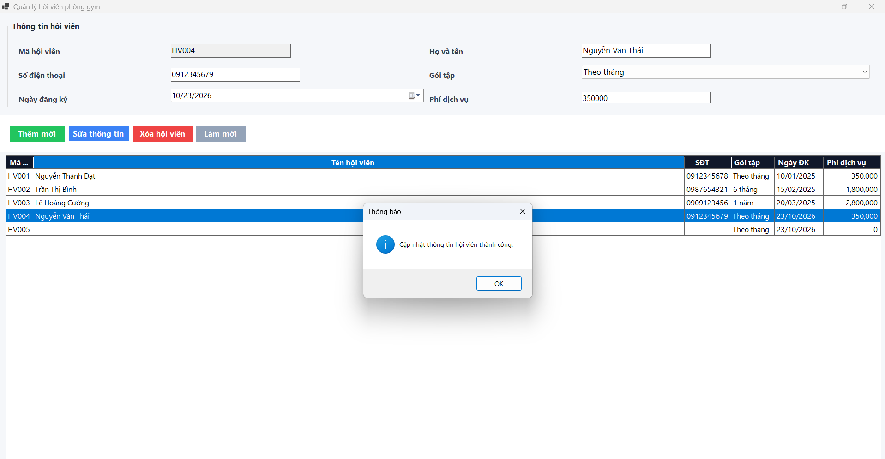
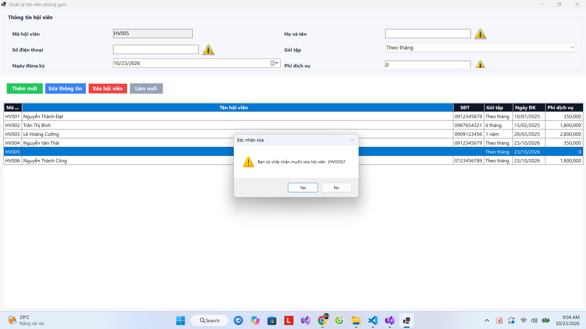
Đồng bộ Data Binding 2 chiều:
- Khi chọn một dòng trên dgvMembers, toàn bộ thông tin hội viên lập tức
được điền vào các Control tương ứng trên Form.
- Khi bấm Sửa thông tin, dữ liệu thay đổi trên Control phải tự động đồng bộ
xuống BindingList<T> và cập nhật ngay lên lưới mà không cần nạp lại
danh sách.
- Khi xóa, hiển thị MessageBox xác nhận (Yes/No) loại cảnh báo
(MessageBoxIcon.Warning). 
### 3. Ảnh màn hình Kiểm tra lỗi (Validation)
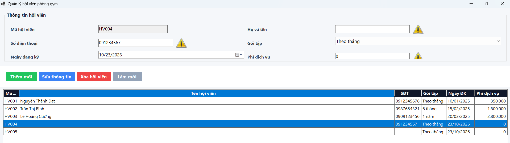

*Mô tả: Kiểm tra hợp lệ dữ liệu nhập vào bằng ErrorProvider khi nhấn Thêm mới.*

---

### Bài 2: Quản lý Tài liệu Sách & Xuất Báo cáo Nhà sách

Kỹ thuật áp dụng: Sử dụng OpenFileDialog để chọn ảnh bìa sách và mở file CSV, SaveFileDialog để xuất dữ liệu sách ra file CSV. Xử lý đọc và ghi file bằng C#, sử dụng BindingList<T> và BindingSource để quản lý, đồng bộ danh sách sách với DataGridView. Quản lý các chức năng thông qua MenuStrip, ToolStrip và StatusStrip.
### 1. Ảnh màn hình Giao diện chính
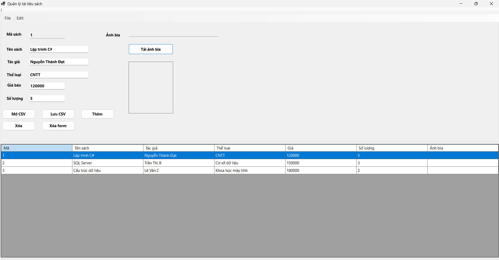
Mô tả: Giao diện chính của hệ thống quản lý sách, bao gồm khu vực nhập thông tin sách, PictureBox hiển thị ảnh bìa, nút Tải ảnh bìa và DataGridView hiển thị danh sách sách. Thanh MenuStrip cung cấp các chức năng mở file CSV, lưu file CSV, thoát, thêm, xóa và tìm kiếm. ToolStrip cung cấp các nút thao tác nhanh, trong khi StatusStrip hiển thị tổng số đầu sách, tổng giá trị sách trong kho và thời gian hiện tại.

### 2. Ảnh màn hình Chức năng thực thi / Kết quả
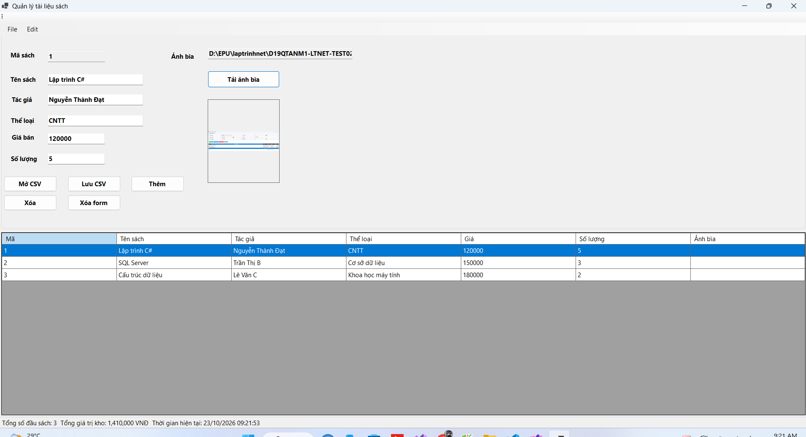
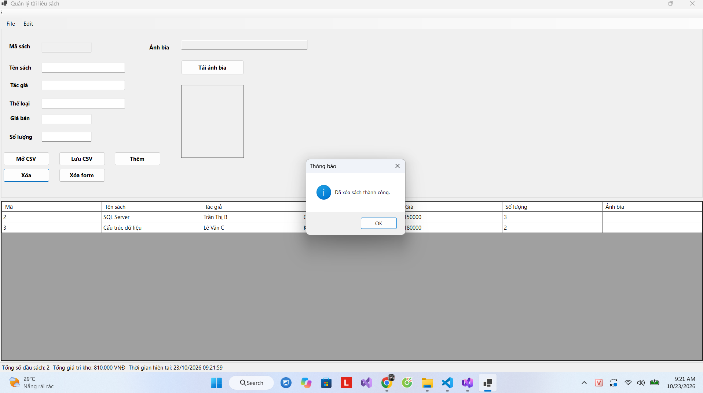
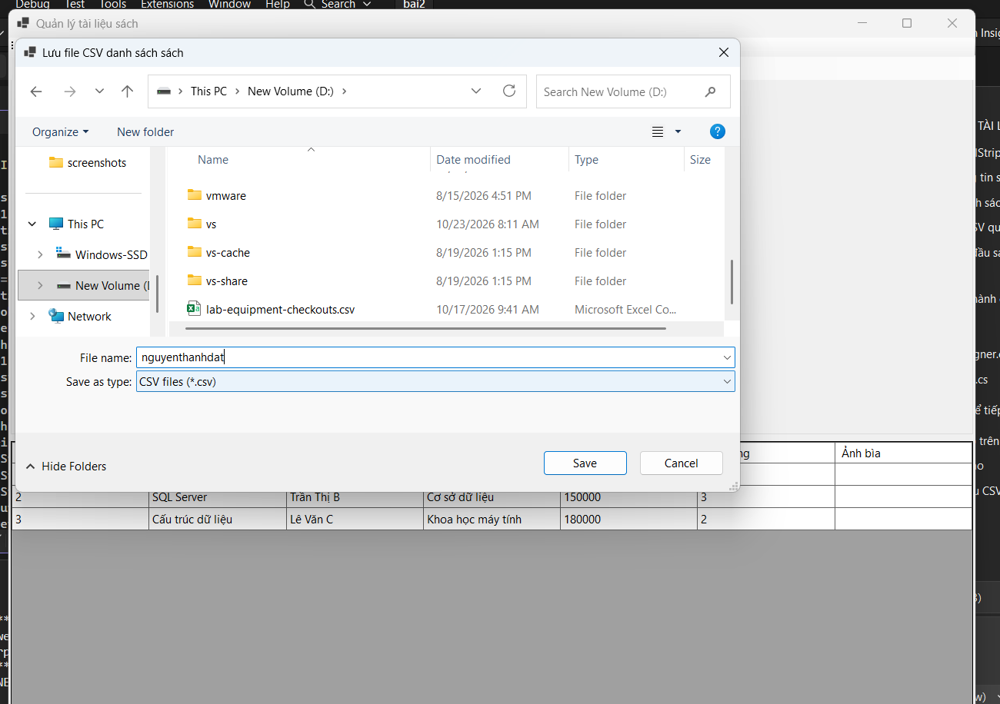
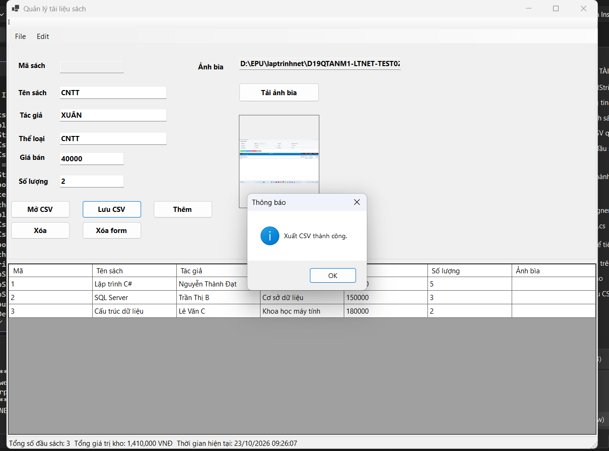
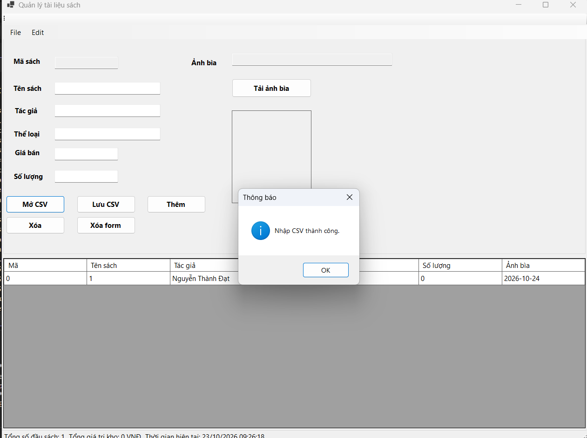
Mô tả: Minh họa chức năng tải ảnh bìa sách bằng OpenFileDialog. Người dùng có thể chọn ảnh định dạng PNG hoặc JPG, ảnh được hiển thị trên PictureBox và đường dẫn ảnh được lưu vào đối tượng sách.

Mô tả: Minh họa chức năng xuất dữ liệu sách ra file CSV bằng SaveFileDialog. Người dùng lựa chọn vị trí lưu file, sau đó hệ thống ghi thông tin các đầu sách vào file để phục vụ lưu trữ và báo cáo.

Mô tả: Minh họa chức năng mở và nhập dữ liệu từ file CSV bằng OpenFileDialog. Hệ thống đọc từng dòng dữ liệu, chuyển đổi thành các đối tượng BookModel và cập nhật danh sách sách thông qua BindingList<T> để hiển thị trên DataGridView.

4. Ảnh màn hình Cập nhật thống kê hệ th

### 3. Ảnh màn hình Kiểm tra lỗi (Validation)

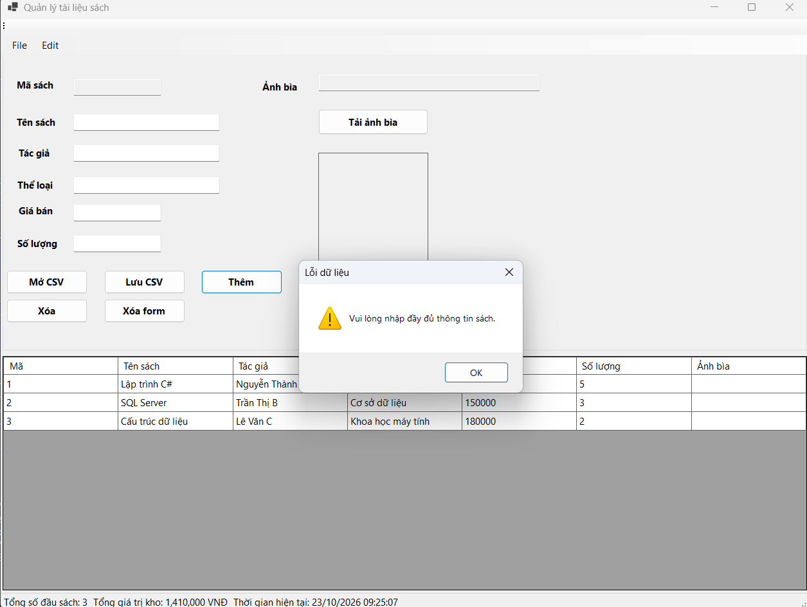
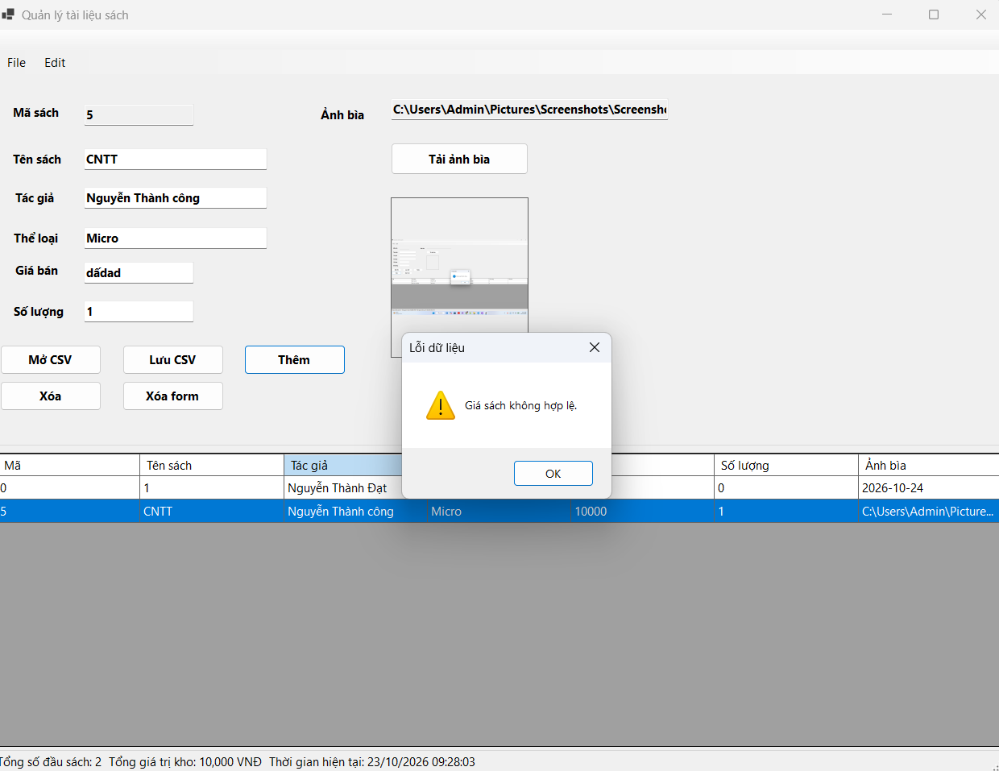

### Bài 3: Hệ thống MDI Quản lý Bệnh viện & Truy xuất Hồ sơ Bệnh án

Kỹ thuật áp dụng: Xây dựng giao diện đa cửa sổ MDI (Multiple Document Interface) với Form cha frmHospitalMain (IsMdiContainer = true). Quản lý vòng đời Form con thông qua MdiChildren, sử dụng Activate() để kích hoạt Form đã mở, tránh mở trùng cửa sổ. Sử dụng MenuStrip để điều hướng chức năng và StatusStrip kết hợp ToolStripProgressBar để hiển thị trạng thái hệ thống.
### 1. Ảnh màn hình Giao diện chính
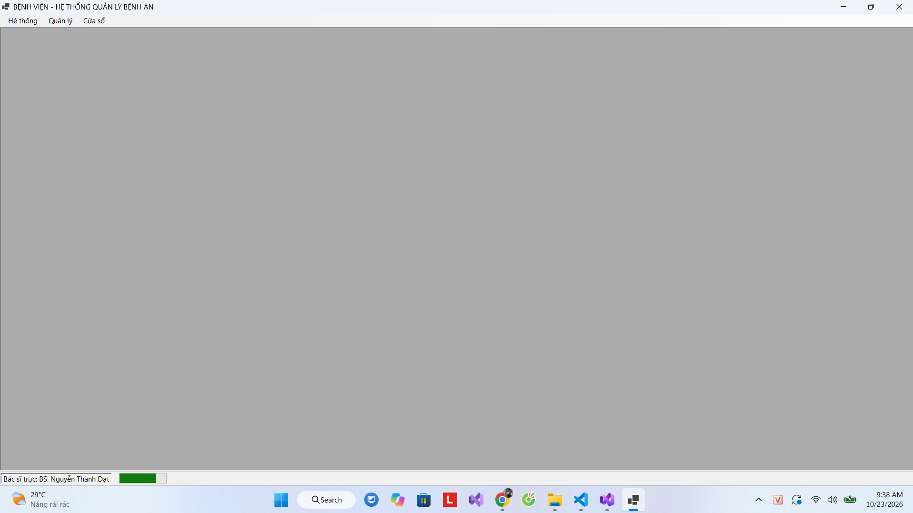
Mô tả: Giao diện chính của hệ thống quản lý bệnh viện được xây dựng theo kiến trúc MDI, bao gồm Form cha frmHospitalMain, thanh MenuStrip với các nhóm chức năng Hệ thống, Quản lý và Cửa sổ. StatusStrip hiển thị thông tin bác sĩ trực và thanh tiến trình của hệ thống.
### 2. Ảnh màn hình Chức năng thực thi / Kết quả
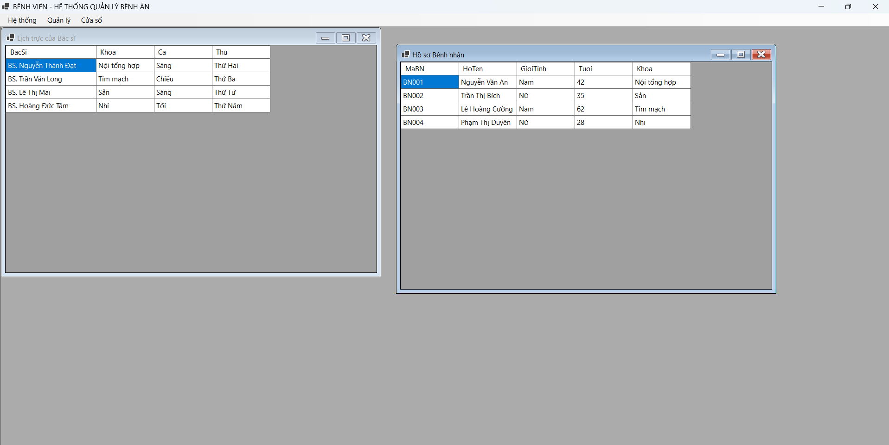
Mô tả: Minh họa chức năng mở Form con Hồ sơ Bệnh nhân (frmPatientProfiles). Khi người dùng chọn chức năng Hồ sơ Bệnh nhân trên Menu Quản lý, hệ thống kiểm tra danh sách MdiChildren. Nếu Form đã mở, chương trình gọi Activate() để đưa cửa sổ lên phía trước; nếu chưa mở, hệ thống tạo Form mới, thiết lập MdiParent = this và gọi Show().

Mô tả: Minh họa chức năng mở Form con Lịch trực Bác sĩ (frmDoctorSchedule) bên trong Form cha MDI, cho phép người dùng quản lý và theo dõi lịch trực của bác sĩ trên cửa sổ riêng.
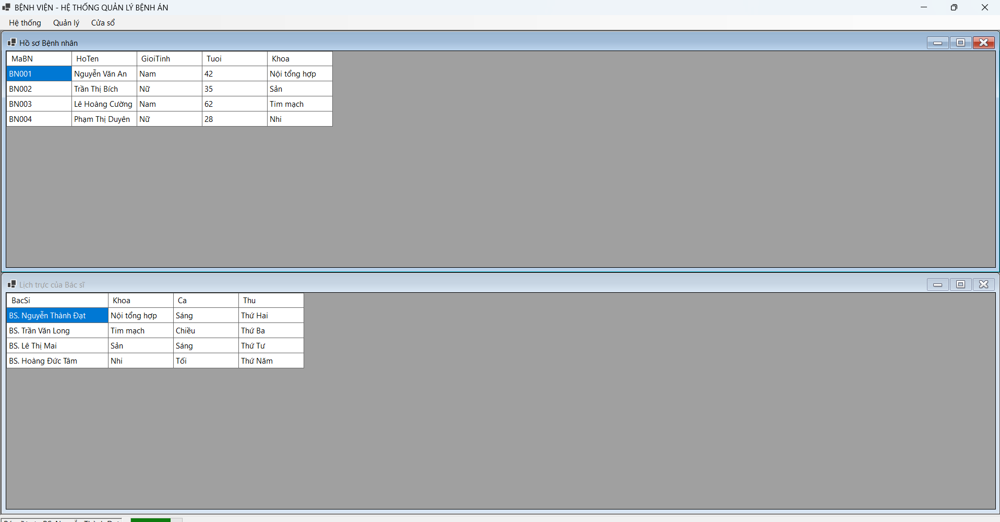
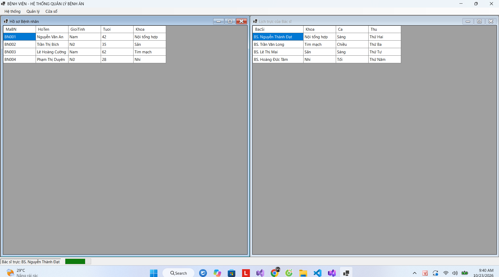
Mô tả: Minh họa các chức năng quản lý cửa sổ trong Menu Cửa sổ, bao gồm sắp xếp xếp tầng (Cascade), sắp xếp ngang (Tile Horizontal), sắp xếp dọc (Tile Vertical) và đóng tất cả cửa sổ con. Các thao tác được áp dụng cho những Form con đang mở trong hệ thống.
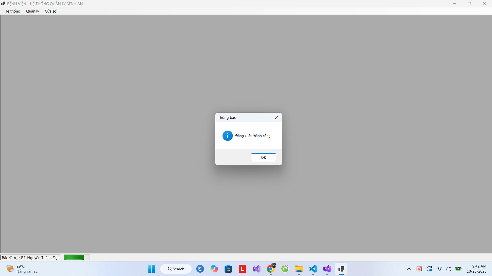

### Bài 4: Bảng điều khiển Thống kê Doanh thu (Async/Await & Không khóa UI)

Kỹ thuật áp dụng: Sử dụng lập trình bất đồng bộ async/await kết hợp Task.Run() để xử lý tác vụ tổng hợp dữ liệu trên Background Thread, giúp giao diện người dùng luôn phản hồi trong quá trình xử lý. Sử dụng CancellationTokenSource và CancellationToken để hủy tác vụ an toàn. Quản lý tiến trình bằng ProgressBar và Label để hiển thị trạng thái xử lý.
### 1. Ảnh màn hình Giao diện chính
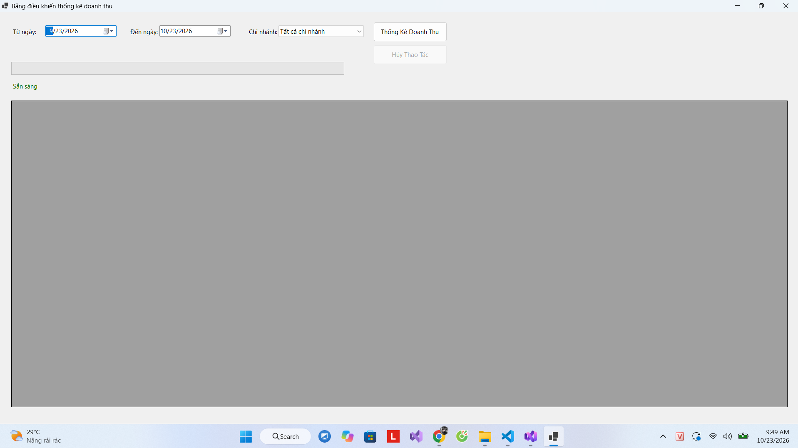
Mô tả: Giao diện chính của bảng điều khiển thống kê doanh thu, bao gồm khu vực chọn khoảng thời gian thống kê, lựa chọn chi nhánh, nút Thống Kê Doanh Thu, nút Hủy Thao Tác, ProgressBar hiển thị tiến trình và DataGridView hiển thị chi tiết các giao dịch.

### 2. Ảnh màn hình Chức năng thực thi / Kết quả
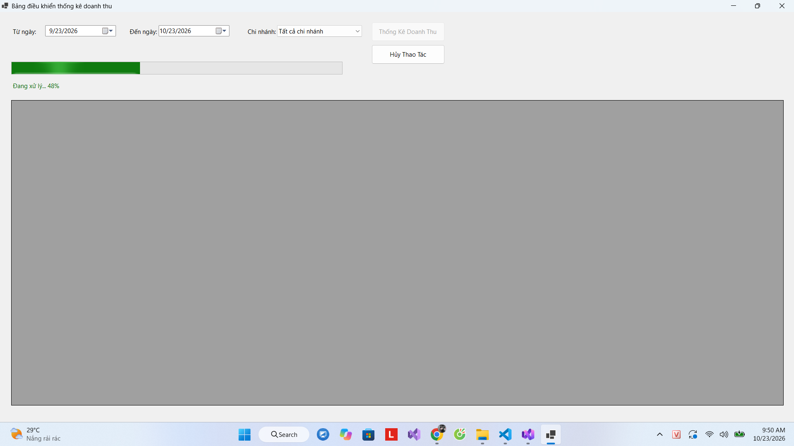
Mô tả: Khi nhấn Thống Kê Doanh Thu, chương trình giả lập quá trình truy xuất cơ sở dữ liệu và tổng hợp lượng lớn giao dịch trong khoảng 4–6 giây. Tác vụ được thực hiện bằng await Task.Run(...), giúp UI Thread không bị khóa. Trong thời gian xử lý, người dùng vẫn có thể di chuyển, phóng to, thu nhỏ cửa sổ và thao tác với các thành phần giao diện khác.
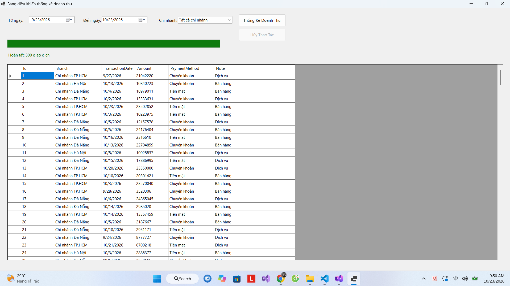
Mô tả: ProgressBar (pgbLoading) và Label (lblProcessingStatus) hiển thị trạng thái, tiến độ xử lý thống kê doanh thu trong quá trình thực thi tác vụ bất đồng bộ.

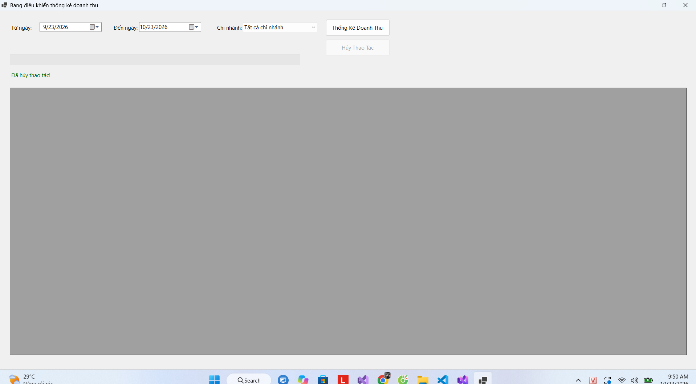
Mô tả: Khi người dùng nhấn Hủy Thao Tác trong lúc thống kê đang chạy, chương trình sử dụng CancellationTokenSource để gửi yêu cầu hủy đến tác vụ nền. Tiến trình được dừng an toàn, ProgressBar được cập nhật và thông báo "Đã hủy thao tác!" được hiển thị cho người dùng.

### Bài 5: Mô phỏng Giám sát Tỷ giá Tài chính Thời gian thực (Cross-Thread Safety & Processing)

Kỹ thuật áp dụng: Sử dụng Task.Run() để khởi chạy tiến trình giám sát tỷ giá chạy ngầm theo chu kỳ 2 giây. Áp dụng Thread Safety trong Windows Forms bằng InvokeRequired và this.Invoke() để chuyển các thao tác cập nhật giao diện về Main UI Thread, tránh lỗi InvalidOperationException. Sử dụng StatusStrip để hiển thị thời gian cập nhật gần nhất và số lượt đồng bộ thành công, kết hợp DataGridView để lưu lại lịch sử biến động tỷ giá.
### 1. Ảnh màn hình Giao diện chính
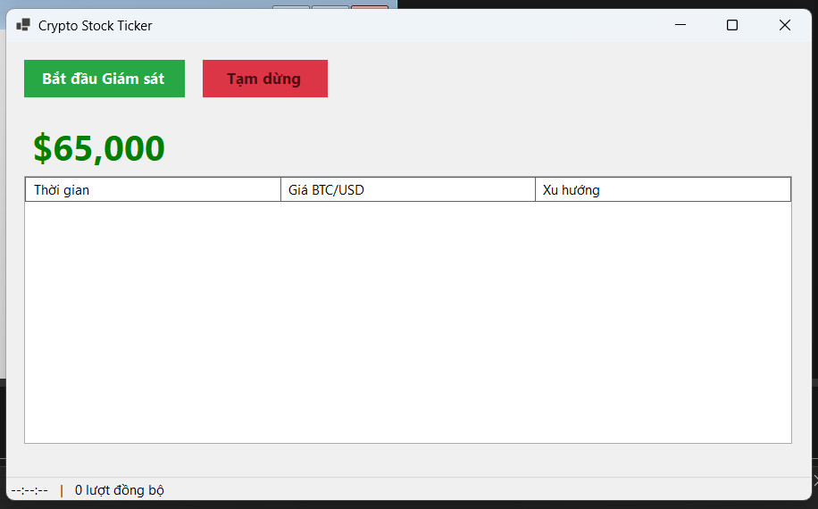
Mô tả: Giao diện chính của ứng dụng giám sát tỷ giá tài chính, bao gồm nút Bắt đầu Giám sát, nút Tạm dừng, Label hiển thị tỷ giá BTC/USD và DataGridView ghi nhận lịch sử biến động giá theo thời gian thực
### 2. Ảnh màn hình Chức năng thực thi / Kết quả
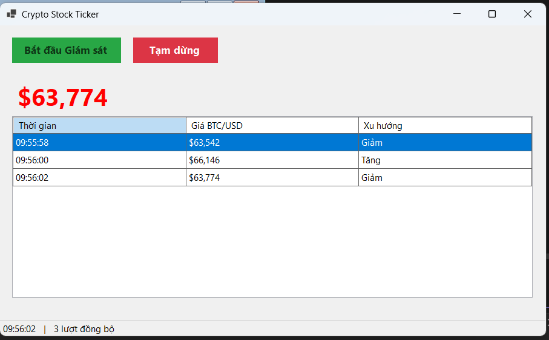

Mô tả: Khi nhấn Bắt đầu Giám sát, chương trình khởi chạy tác vụ nền bằng Task.Run() và định kỳ mỗi 2 giây tạo ra tỷ giá BTC/USD giả lập. Giá mới được so sánh với giá trước 